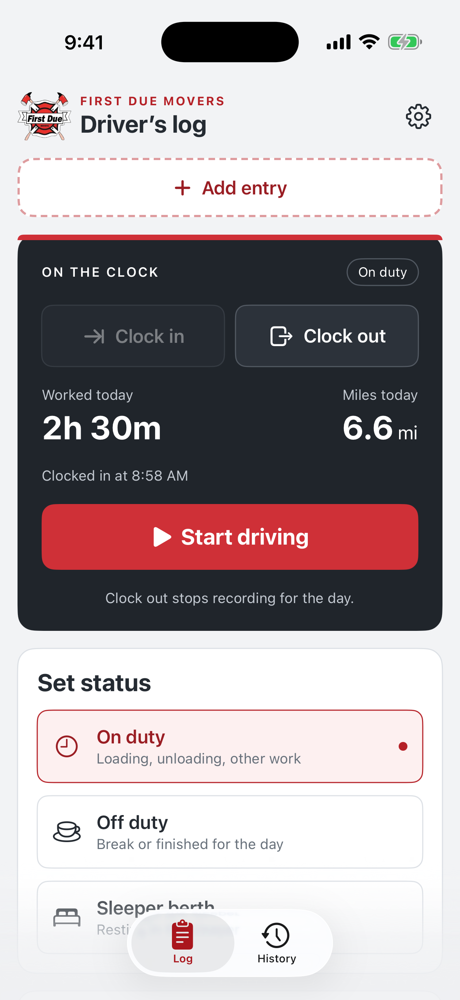
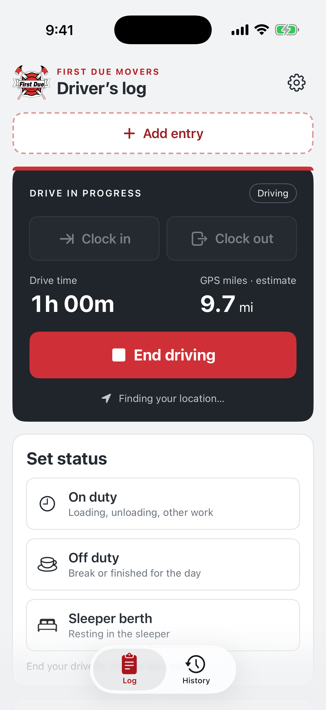
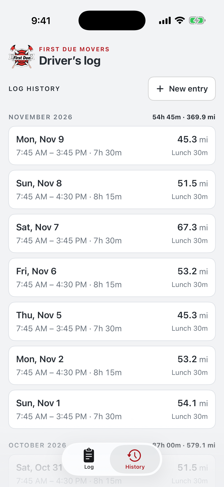
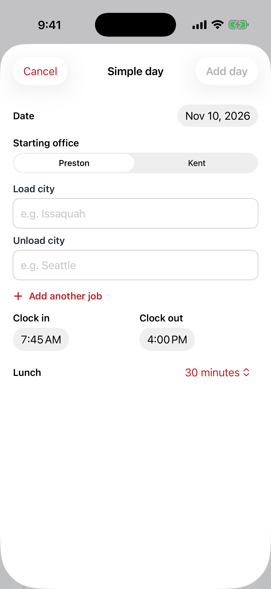

# First Due Driver’s Log

A driving and duty log for First Due Movers drivers. It keeps a DOT-style duty chart (record of duty status) for every day: estimated from a few answers on local days, and filled in stop by stop on long-distance (LD) days. Every day's record is kept on the web and on iPhone.

**Live site:** https://first-due-driver-log-eric.netlify.app
**Status:** website in daily use · iPhone app in testing ([#13](https://github.com/EricTalanoa/first-due-driver-log/pull/13)) · App Store next

| Log | Drive in progress | History | Simple day |
|---|---|---|---|
|  |  |  |  |

<sub>iPhone app with sample data, captured by CI on every change to `ios/`.</sub>

## What it does

The website has three tabs: **Today**, **LD** and **History**.

- **Today.** *Add entry* at the top, then the day's DOT chart: 24 hours across the four duty lines (off duty, sleeper berth, driving, on duty), 15-minute ticks, totals for each line, and remarks with the time and place of every change. Time with no entry counts as off duty, so a finished day adds up to 24:00. Tap a stretch of the chart to edit that entry.
- **Simple day** (local jobs). Enter load and unload cities, clock times and lunch; the day is laid out with estimated drive times and miles. Under the short-haul exception this time record is what the rules ask for on local days. Saved days reopen with **Edit day**.
- **LD.** The live long-distance log. One set of buttons shows what can come next (Clock in → Start driving → Fuel stop, Quick break, Lunch, Start unload, Switch drivers, Arrive · post-trip, Clock out). Each tap asks for the time (now by default) and the place; clock-in suggests the hotel if yesterday ended at one. The page starts empty each day; the clocks appear once you clock in. Fueling is logged as on duty, as the rules require. Ending a drive estimates its miles from the two places.
- **Hours-of-service clocks** on the LD tab: driving left of 11 hours, work window left of 14, time until the 30-minute break is due, and hours left of 70 in 8 days.
- **Inspection view.** Today and the previous 7 days with the driver, carrier, truck and terminal details, ready to show or print.
- **Fill in or fix a day.** The same steps as a list (time, activity, place, miles) for filling in an LD day after the fact or fixing any finished day. A time earlier than the step before it is read as after midnight; the chart splits the day at midnight.
- **Estimate an LD day.** The quick estimate from start, unload and end places, as before.
- **History.** Days grouped by month with monthly hours and miles; tap a day to open it. Long-distance days are outlined in red, and back-to-back LD days are grouped as one trip. A day counts as LD if it was logged on the LD tab or with the LD estimate, has a hotel stop, or reaches a place more than 150 air-miles from Preston.
- **Your data.** CSV export of every entry, JSON backup and import, print or PDF of a day.
- **Accounts.** Sign in with email or Google; each driver sees only their own log, on every device.

Miles are estimates: each place is matched to a city in the app's list, and the straight-line distance is scaled for roads (usually within about 10% on highway trips). A place outside the list asks for miles. The Kent office closed, so new days start at Preston; older Kent days still open. GPS tracking is shelved on the website (it is in the git history before this change). This is a personal logbook, not a certified ELD: drivers who keep logs on more than 8 days in any 30 generally need an ELD.

## How it's built

| Part | Stack | Where |
|---|---|---|
| Website | React + Vite, deployed by Netlify from `main` | `app/`, `lib/`, `index.html` |
| Data & sign-in | Supabase (Postgres, row-level security, email + Google auth) | `supabase/migrations/` |
| iPhone app | SwiftUI, built from Windows with [xtool](https://github.com/xtool-org/xtool) | `ios/` |
| CI | GitHub Actions on macOS: core tests, iOS build, simulator screenshots | `.github/workflows/ios.yml` |

Both the website and the app read and write the same Supabase tables:

- `profiles`: driver and vehicle details.
- `entries`: one row per duty period. The row with no end time is the one being recorded now. A database rule stops duty periods from overlapping.
- `save_log()`: applies each change in one transaction; clients send only what changed.

The publishable Supabase key is in `lib/supabase.ts` and `ios/Sources/DriverLog/Backend.swift`. It's safe to ship because row-level security limits every query to the signed-in driver.

### Duty chart and hours of service

`lib/hos.ts` holds what each LD step means, the timeline ↔ entries conversion, the filled-in chart line and the hours-of-service clocks. `app/hos-chart.tsx` draws the chart; `app/ld-page.tsx` is the LD tab, the inspection view and the fill-in editor.

The iPhone app still has the earlier Log screen and GPS. It reads the same entries, so LD days logged on the web show up there.

## Working on it

**Website**

```sh
npm ci
npm run build:netlify      # production build into netlify-dist/
npx netlify dev            # local dev at http://localhost:8888
```

Use Node.js 22.13 or newer. No environment variables are needed. Pushing to `main` deploys to Netlify, and pull requests get a preview link.

**iPhone app** — see [`ios/README.md`](ios/README.md). In short, from WSL Ubuntu with the iPhone relayed through the Windows Apple Devices app:

```sh
cd ios
xtool dev
```

**Database changes** go in `supabase/migrations/` and are applied to the Supabase project.

## Roadmap

- [x] Simple day with multiple jobs, Edit day, Clear day; better GPS on the web ([#10](https://github.com/EricTalanoa/first-due-driver-log/pull/10))
- [x] Supabase database and sign-in with Google; import of the old log ([#11](https://github.com/EricTalanoa/first-due-driver-log/pull/11))
- [x] History grouped by month ([#12](https://github.com/EricTalanoa/first-due-driver-log/pull/12))
- [ ] iPhone app with background GPS ([#13](https://github.com/EricTalanoa/first-due-driver-log/pull/13), in testing)
- [ ] App Store: Sign in with Apple, privacy policy, signed TestFlight builds from CI
- [ ] Remove the unused starter scaffolding (see below)

## Repository notes

The project began from a starter template. These folders and files are left over from it and aren't used by the website or the app:

- `components/ui/`, `db/`, `drizzle/`, `examples/`
- `build/`, `scripts/`, `vendor/`
- `cloudflare-env.d.ts`, `next.config.ts`, `vite.config.ts`, and the `dev`/`build`/`start` npm scripts

The live site builds with `vite.netlify.config.ts` and `npm run build:netlify`.
